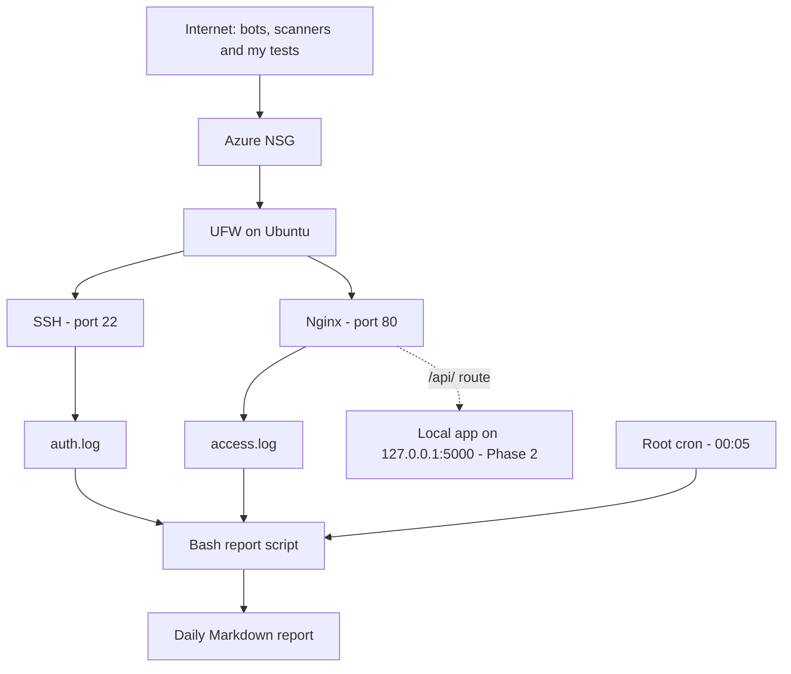
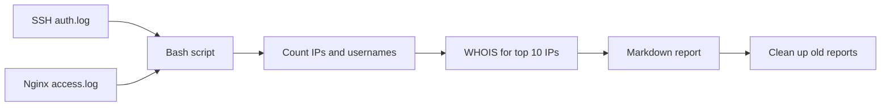

# Attack Watch

A Linux server on Azure that I left open to the internet on purpose, so I could watch automated attacks arrive, record them and turn them into a daily report with Bash.

## What this project is

A public server can start getting scanned by bots within minutes of going online. I wanted to see that happen myself.

Attack Watch is a shell-based system that records which usernames bots try, which IP addresses they come from, which countries those IP blocks are registered in, and which web paths they look for. Every night, a Bash script turns the logs into a Markdown report.

## Architecture



A request has to get through two firewalls. The Azure NSG is outside the VM, and UFW is inside it. Both allow only ports 22 and 80 for incoming traffic. Everything else is blocked by default.

Nginx serves a static page on port 80. I also configured a reverse-proxy route for `/api/`, which points to `127.0.0.1:5000`. The Python app is for Phase 2, so it is not part of the current reporting system. When I add it, it will only listen locally, not directly on the internet.

## Security choices

- **SSH is open to the whole internet on purpose.** That is the point of the project: I want to see the bots come. In a real company, I would limit SSH access to my own IP, a VPN or Azure Bastion.
- **SSH keys are required.** Password login, keyboard-interactive login and root login are turned off. I also limited login attempts and login time. I put these settings in my own file under `sshd_config.d/` and checked the settings actually being used with `sshd -T`.
- **Two firewalls, both default deny.** Azure NSG and UFW only allow SSH and HTTP traffic in.
- **Internal services stay local.** The planned app behind Nginx will listen on `127.0.0.1`, so it cannot be reached directly from the internet.
- **No personal IPs or keys in this repo.** My private settings are kept outside the repo, in a restricted config file on the server. `.gitignore` also excludes `.env` and key files.
- **The report script belongs to root.** Root runs the scheduled task, and normal users cannot edit the deployed script.
- **Recovery path:** Azure Serial Console, in case I lock myself out of SSH.

## How the daily report works

Root's crontab runs `attack-report.sh` every night at **00:05 server time**. The script reads the SSH and Nginx logs and writes a file like `attackwatch-2026-11-14.md` to `/srv/reports`.



Each report has six sections:

1. Date and server name
2. Total SSH authentication log entries matching the patterns I track
3. Number of different IPs
4. Top 10 usernames tried
5. Top 10 IPs and the countries their IP blocks are registered in (`whois`, only for these 10)
6. Top 10 paths requested from Nginx (with my configured IPs filtered out)

A small but important detail: **the script counts matching log lines, not necessarily separate login sessions**. One SSH connection can create more than one log line. Also, the current script reads the whole log file available at that time, not just the last 24 hours. I want to change that in Phase 2.

Other details:

- I use `set -euo pipefail` to catch script errors and unset variables. I handle cases where `grep` finds nothing, because that is not always a real error for this report.
- If a log file is missing or unreadable, the script prints an error to stderr and stops.
- I can choose the report directory with the first command-line argument. Otherwise it uses `/srv/reports`.
- Old `attackwatch-*.md` files are cleaned up with `find` and `-mtime +30`. The search stays in the report folder itself, not its subfolders.
- The script passes ShellCheck without warnings.

### A small example of the output

```text
# 2026-11-14 ubuntu24
## Total Attempt: 11412
## Amount of Different IPs: 164
## Top Usernames:
    4050 root
    2327 admin
    1503 user
```

The full report also includes the top IPs, their WHOIS country codes and the most requested web paths.

### How to run it

This repo shows how I built my own server. It is **not a one-command installer**. You need your own Ubuntu machine, the right log paths and the config values used by the script. The script also needs tools like Bash, `grep`, `awk`, `sed` and `whois`.

On my Azure server, the deployed script is at `/usr/local/bin/attack-report.sh`. I can run it manually with:

```bash
sudo /bin/bash /usr/local/bin/attack-report.sh /srv/reports
```

The last part, `/srv/reports`, is the output folder. I can replace it with another folder if I want.

To run it every night, I added this to root's crontab (`sudo crontab -e`):

```cron
5 0 * * * /bin/bash /usr/local/bin/attack-report.sh /srv/reports >> /var/log/attackwatch-cron.log 2>&1
```

The `>>` adds output to the log instead of replacing it. `2>&1` sends error messages there too. The time is based on the server's timezone.

I checked that cron ran the script and that the report was created with:

```bash
sudo journalctl -u cron --since "1 day ago"
sudo ls -lh /srv/reports/
```

## Findings

> These numbers come from my own logs. My first week of notes covers **2–7 November 2026**. The later `auth.log` snapshot was taken on **14 November 2026** and covers **8–14 November**.

**The first login attempt came after about 4 minutes.** The VM was created on 1 November at 23:58 UTC. The first attempt showed up at 00:01:57 UTC on 2 November, with an empty username.

**11,412 matching SSH log entries from 164 different IPs** in one `auth.log` snapshot.

### Top 10 usernames

| Username | Times seen in the log |
| --- | ---: |
| root | 4050 |
| admin | 2327 |
| user | 1503 |
| debian | 830 |
| ubuntu | 789 |
| user2 | 621 |
| test | 82 |
| ftpuser | 52 |
| administrator | 51 |
| oracle | 42 |

**The same numbers kept showing up.** Five IPs made exactly 499 entries each, and another five made 412 each. They came from IP blocks registered in Germany, Cameroon, Turkey, India, the Netherlands, Australia and China. That made me think some of them might be running the same script or word list. I can't prove they are part of the same botnet just from those counts. I saw similar pairs at 330 and 412 during the first week.

**Country is not the attacker's location.** WHOIS tells me where an IP block is registered, not where the person using it actually is. Many of the busiest IPs belonged to hosting and cloud providers. During the first week, three of the top 10 were from the same provider. One looked like a home ADSL connection. It might have been a compromised device, but the logs alone can't tell me that.

**Bots never sleep.** During the first week, no hour in the logs I checked had fewer than 100 matching entries. The peaks were around 18:00 and 06:00 Budapest time.

**What they guess:**

- Default users of cloud images and services: `ubuntu`, `debian`, `ec2-user`, `pi`, `oracle`, `postgres`.
- AI dev tool names: `claude`, `codex`, `cursor`, `deepseek`.
- Crypto and finance accounts: `solana`, `eth-validator`, `bankadmin`.

**What they look for on the web:**

- `.env` files and their backups
- `.git/config`
- `wp-config.php`
- `phpinfo` pages
- AI tool endpoints like `/mcp` and `/sse`

A lot of requests were looking for files that people sometimes leave online by mistake. Some also looked like tests for an open proxy. The suspicious requests I checked returned 404, so those paths did not expose anything.

**Some scanners introduce themselves.** I saw User-Agent names such as Censys, Palo Alto Cortex Xpanse, Infrawatch and Nokia's GenomeCrawler. Others just used names like `zgrab`, `python-requests` or `Go-http-client`. Of course, a User-Agent is just text the client sends, so it doesn't prove who made the request.

## What I learned

I learned a lot. Before this project, I didn't even really know what SSH was. Now I am comfortable in the terminal and can find my way around a Linux server. I learned to use Azure properly and to pick only the services a task needs. I learned NSGs, firewalls and the details of system security. I had no idea how many automated login attempts a server gets until I saw them myself.

I learned how Nginx is structured and what happens when a browser opens a website: DNS finds the IP, then the TCP connection and HTTP request follow. I also learned where TLS comes in when using HTTPS. I learned Linux permissions and why they matter. I learned regex in this project, and pulling exactly what I need out of a messy log file took real effort. I also learned to get more detail out of an IP address. Most of all, my Git skills went up a level.

**Lessons from breaking things on purpose** (full notes in `docs/incidents/`):

- **Timeout and refused mean different things.** A timeout can mean a firewall dropped the packet. Refused can mean the connection got through, but no service was listening. They are clues, not absolute rules.
- **403 and file permissions.** In my case, Nginx returned 403 because `www-data` could not read the file it needed.
- **502 and the app behind the proxy.** In my test, Nginx couldn't get a proper response from the app behind it.
- **Test the config before reloading.** I use `nginx -t` first. A failed reload can leave the old config running, while restarting with a broken config can take the site down.
- **`df` shows that the disk is filling, `du` shows where.**
- **In strict Bash, `grep` returns 1 when it finds nothing.** That alone stopped my report once. Now I handle no-match cases on purpose and test them.
- **Compare the numbers after every change.** A careless find-and-replace broke one search pattern. No error appeared, but `root` quietly disappeared from the report.

## Repository layout

| Path | Contents |
| --- | --- |
| `scripts/` | The report script |
| `config/ssh/` | My SSH hardening file |
| `config/nginx/` | My Nginx site config |
| `docs/incidents/` | Notes on what broke, why, and how I fixed it |
| `NOTES.md` | My learning notebook, one section per part |

## Next steps

- A nightly backup of the configs and reports, and a systemd timer as an alternative to cron.
- Count only the last 24 hours in each daily report, instead of the whole current log file.
- Phase 2: a Python API and a database for the attack data, Docker, and Grafana dashboards.
